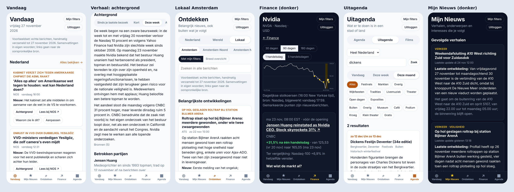

# NewsZoom

Volg wat je boeit. Zie wat er verandert.

NewsZoom is een concept voor een persoonlijke nieuwsapp. Je kiest zelf welke onderwerpen en verhalen in je feed komen. Bij iedere update kun je uitzoomen naar de afgelopen week, de afgelopen maanden of het hele verhaal. In Finance doe je hetzelfde voor koersbewegingen en het nieuws eromheen. In Agenda zie je geplande evenementen, reisinformatie en filmreleases die bij je voorkeuren passen. Met de Uitagenda ontdek je wat er vandaag, deze week of deze maand te doen is in een stad of land.

**Status:** live op https://newszoom.craftstudio.work. Vandaag, Mijn Nieuws, Ontdekken met Lokaal Amsterdam, dossiers, filters per sectie, Finance, Agenda/Uitagenda, ingest-worker, Android-app, achtergrond op aanvraag met AI (budget en tokenteller) en Instellingen met bronnen per doel.

## Zo ziet het eruit



Losse schermen staan in [docs/schermen](docs/schermen).

## Lokaal draaien

```bash
npm install
cp .env.example .env.local
npm run migrate
npm run dev
```

Lokaal zonder craftstudio-instellingen log je in als testgebruiker. Feeds ophalen: `npm run ingest -- --once`. Tests: `npm test`.

## Documentatie

| Document | Inhoud |
| --- | --- |
| [SETUP](docs/SETUP.md) | Architectuur, gegevensmodel en bouwvolgorde |
| [SERVER_SETUP](docs/SERVER_SETUP.md) | Draaiboek voor de Hetzner-server en Cloudflare |
| [OWNER_SETUP](docs/OWNER_SETUP.md) | Wat de eigenaar zelf instelt, met GitHub-commando's |
| [DEPLOYMENT](docs/DEPLOYMENT.md) | Handmatige releaseprocedure |
| [ANDROID](docs/ANDROID.md) | Capacitor-app en APK-workflow |
| [BUILD_LOG](docs/BUILD_LOG.md) | Uitgevoerde werkzaamheden en status |
| [Functioneel ontwerp](docs/FUNCTIONEEL_ONTWERP.md) | Persoonlijke feed, verhaalpagina en context |
| [Finance](docs/FINANCE.md) | Marktbewegingen, koersen en nieuwe informatie |
| [Agenda](docs/AGENDA.md) | Evenementen, bereikbaarheid, filmreleases en persoonlijke filters |
| [MVP](docs/MVP.md) | Eerste prototype en wat we ermee willen toetsen |
| [Besluiten](docs/BESLUITEN.md) | Besproken keuzes, voorstellen en open vragen |
